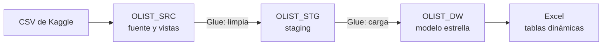
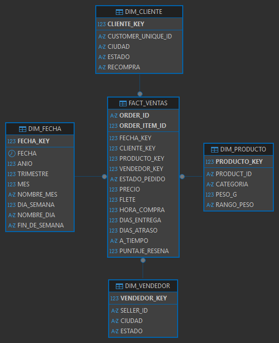
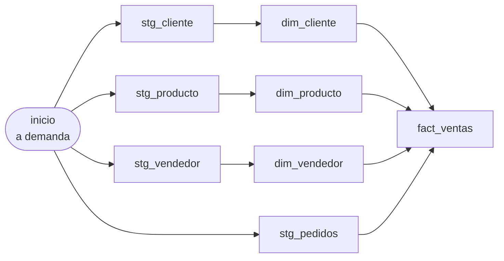

# Data Warehouse para Invacom Inc S.A.

Proyecto #1 del curso **ISW-911 Minería de Datos** (3C2026), grupo 01.

Invacom quiere un data warehouse para analizar las ventas de un marketplace. Aquí están los scripts
SQL, los jobs de ETL y la documentación.

**Integrantes:** Josué, Karol, Katherine y Dylan.

## Documentos

| Documento | Qué tiene |
|---|---|
| [Preguntas de negocio](docs/preguntas-de-negocio.md) | Las 5 preguntas que responde el DW |
| [Modelo dimensional](docs/modelo-dimensional.md) | El modelo estrella, la granularidad y las medidas |
| [Calidad de datos](docs/calidad-datos.md) | Los problemas de la fuente y la regla de limpieza de cada uno |
| [Vistas de extracción](sql/src/vistas.sql) | Una vista por tabla del DW, con su forma |

## La base: Olist

*Brazilian E-Commerce Public Dataset by Olist*: compras reales de un marketplace brasileño entre
2016 y 2018. Son 9 CSV (121 MB) que no se suben al repo; se descargan de
[Kaggle](https://www.kaggle.com/datasets/olistbr/brazilian-ecommerce).

<details>
<summary>Las 9 tablas y sus filas</summary>

| Tabla | Filas |
|---|---|
| `olist_orders_dataset` | 99 441 |
| `olist_order_items_dataset` | 112 650 |
| `olist_order_payments_dataset` | 103 886 |
| `olist_order_reviews_dataset` | 99 224 |
| `olist_customers_dataset` | 99 441 |
| `olist_sellers_dataset` | 3 095 |
| `olist_products_dataset` | 32 951 |
| `olist_geolocation_dataset` | 1 000 163 |
| `product_category_name_translation` | 71 |

</details>

## Arquitectura



Oracle Database 21c XE, PDB `XEPDB1`. Las tres etapas son tres esquemas del mismo Oracle:

| Esquema | Qué tiene |
|---|---|
| `OLIST_SRC` | Los CSV tal cual, sin limpiar, y las vistas de extracción |
| `OLIST_STG` | Lo que limpió Glue |
| `OLIST_DW` | El modelo estrella |

Antes de cada tabla del DW se hizo una vista en `OLIST_SRC` con su forma (`v_dim_cliente`,
`v_dim_vendedor`, `v_dim_producto` y `v_fact_ventas`), para revisar cómo iba a quedar. Los jobs
leen de esas vistas.

## El modelo

Una tabla de hechos, `fact_ventas` (un ítem de pedido por fila), y cuatro dimensiones: fecha,
cliente, producto y vendedor. El detalle está en [modelo-dimensional.md](docs/modelo-dimensional.md).



## Cómo se corre el ETL

El ETL completo es el workflow `olist_etl` de AWS Glue, en la región **us-east-2 (Ohio)**. Corre
los 8 jobs de `glue/` en orden:



- Los 4 `stg_*` corren a la vez.
- Cada `dim_*` arranca cuando su `stg_*` termina bien.
- `fact_ventas` espera a las 3 dimensiones y a `stg_pedidos` (trigger con *ALL*).
- `dim_fecha` no tiene job: se carga una sola vez con `sql/dw/01_tablas.sql`.

Para correrlo: Glue → *Workflows (orchestration)* → `olist_etl` → *Run workflow*. En *History* se
ve cada job. Tarda unos 6 minutos.

Se puede correr las veces que haga falta: las dimensiones y `fact_ventas` se cargan con `MERGE`, y
cada job se cae si los datos no cuadran con la fuente. Después de una corrida, `sql/validacion.sql`
tiene que dar las 26 pruebas en OK.

Cada job necesita estos parámetros: `--ORA_URL` (termina en `/XEPDB1`), `--ORA_USER` (`glue_etl`)
y `--ORA_PASSWORD`. Además usa el rol `glue-olist-rol` y el JAR
`s3://mineria-olist-g01-glue/jars/ojdbc8-21.9.0.0.jar`.

## Acceso

Cada uno entra con su usuario, que puede leer `OLIST_SRC`. Para trabajar en staging o en el DW se
entra por proxy, con la misma contraseña:

- `usuario[olist_stg]` para staging
- `usuario[olist_dw]` para el DW

En el usuario personal no se pueden crear tablas: todo va en `OLIST_STG` o `OLIST_DW`. Glue entra
igual, con `glue_etl`.

## Estructura del repo

```
olist-carga/            Carga de OLIST_SRC con SQL*Loader
calidad-datos/          Consultas de calidad sobre OLIST_SRC
sql/esquemas.sql        Crea OLIST_STG y OLIST_DW y los proxys
sql/src/vistas.sql      Vistas de extracción: una por tabla del DW, con su forma
sql/stg/                Tablas de staging, una por job stg_*
sql/dw/01_tablas.sql    Tablas del modelo estrella y carga de dim_fecha
glue/                   Jobs de Glue (plantilla.py es la base de todos)
  stg_*.py              De OLIST_SRC a OLIST_STG: extraen y limpian
  dim_*.py, fact_*.py   De OLIST_STG a OLIST_DW: cargan el modelo estrella
docs/                   Preguntas de negocio, modelo dimensional y calidad de datos
```

<details>
<summary>Cómo se cargó <code>OLIST_SRC</code></summary>

Con SQL\*Loader: un `.ctl` por CSV, y `cargar.sh` los corre todos y muestra filas cargadas y
rechazadas.

1. `olist-carga/01_tablas.sql`, como `OLIST_SRC`.
2. `olist-carga/cargar.sh`, dentro del contenedor de Oracle. La contraseña se pasa por la entrada
   estándar.
3. `olist-carga/02_llaves.sql`, como `OLIST_SRC`.

Quedaron las mismas filas que en el Excel del profesor, con 0 rechazos. Los datos se cargaron sin
limpiar, porque la limpieza es parte del ETL.

- `olist_geolocation_dataset` no tiene llave primaria (el código postal se repite).
- La FK de productos a la traducción de categorías está en `DISABLE NOVALIDATE`, porque 13
  productos tienen una categoría sin traducción.
- Para recargar hay que desactivar antes las FK, o el `TRUNCATE` falla (`ORA-02266`).

</details>

## Forma de trabajo

- Scrum con sprints de una semana, con el tablero en Trello.
- Cada integrante sube sus propios commits.
- No se suben contraseñas ni datos: el `.gitignore` deja fuera los CSV, los `.env` y las salidas de
  SQL\*Loader.
- Los `.sh`, `.ctl`, `.sql` y `.py` se guardan con saltos de línea LF (lo fuerza el
  `.gitattributes`).
