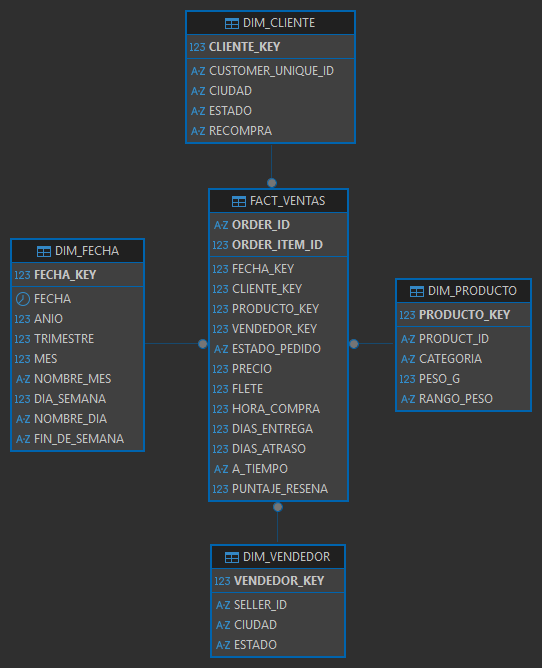

# Modelo dimensional — Invacom Inc. S.A.

Modelo estrella del data warehouse `OLIST_DW`. Las tablas se crean con `sql/dw/01_tablas.sql`.
Los conteos de filas salen de `OLIST_SRC`.

## Diagrama

Una tabla de hechos al centro, `FACT_VENTAS`, y cuatro dimensiones a su alrededor: `DIM_FECHA`,
`DIM_PRODUCTO`, `DIM_CLIENTE` y `DIM_VENDEDOR`. Cada dimensión se une al hecho por una sola llave.

El diagrama muestra **solo el esquema `OLIST_DW`**. El modelo entidad-relación de la base fuente
(`OLIST_SRC`, con sus 9 tablas normalizadas) es otro modelo y no se mezcla con este.

## Por qué un modelo estrella

- **Pensado para consultar, no para registrar.** La base fuente está normalizada para guardar
  transacciones sin repetir datos. El data warehouse está pensado para resumir: sumar ventas,
  promediar tiempos y filtrar por fecha, producto, cliente o vendedor.
- **Dimensiones planas.** Cada dimensión es una sola tabla con todo lo que describe a su entidad. Por
  ejemplo, la categoría (ya traducida al inglés) va dentro de `DIM_PRODUCTO`, en vez de en una tabla
  aparte como en la fuente. Si las dimensiones se partieran en subtablas, sería un copo de nieve.
- **Consultas simples.** Cualquier pregunta se contesta con el hecho y un join directo a cada
  dimensión que se necesite. Esa forma es la más cómoda para armar las tablas dinámicas de Excel.
- **Un solo proceso de negocio:** la venta. Por eso hay una sola tabla de hechos.

La alternativa era una **constelación**, con una segunda tabla de hechos `fact_pedidos` para los datos
que son del pedido entero. Quitaba la repetición de esos datos, pero pedía un segundo job de hechos
en el ETL. Se eligió la estrella porque responde las 5 preguntas con una sola tabla de hechos.

## Granularidad

**Una fila de `FACT_VENTAS` es un producto dentro de un pedido** (un ítem de pedido): 112 650 filas.

- La llave primaria es `order_id + order_item_id`, la misma combinación que identifica un ítem en la
  fuente (`olist_order_items_dataset`).
- Si un pedido trae 3 productos, genera 3 filas.
- Se eligió el grano más fino disponible para poder analizar por producto, categoría y vendedor. Un
  pedido puede tener productos de distintos vendedores, así que un grano por pedido no permitiría
  saber cuánto vendió cada uno.
- Las filas salen de los ítems, así que los 775 pedidos que no tienen ningún producto no entran al
  hecho.

## Tabla de hechos: `FACT_VENTAS`

| Columna | Tipo de columna | Qué guarda |
|---|---|---|
| `fecha_key` | Llave a `DIM_FECHA` | Día de la compra |
| `cliente_key` | Llave a `DIM_CLIENTE` | Quién compró |
| `producto_key` | Llave a `DIM_PRODUCTO` | Qué se vendió |
| `vendedor_key` | Llave a `DIM_VENDEDOR` | Quién lo vendió |
| `order_id` | Dimensión degenerada (PK) | Código del pedido |
| `order_item_id` | Dimensión degenerada (PK) | Número del producto dentro del pedido (1, 2, 3…) |
| `estado_pedido` | Dimensión degenerada | `delivered`, `shipped`, `canceled`, etc. |
| `precio` | Medida del producto | Precio del producto |
| `flete` | Medida del producto | Costo de envío asignado a ese producto |
| `hora_compra` | Dato de la compra | Hora del día (0–23) en que se hizo el pedido |
| `dias_entrega` | Medida del pedido | Días desde la compra hasta la entrega al cliente |
| `dias_atraso` | Medida del pedido | Días de diferencia entre la entrega real y la fecha prometida |
| `a_tiempo` | Medida del pedido | `S` si llegó en la fecha prometida o antes, `N` si no |
| `puntaje_resena` | Medida del pedido | Puntaje de la reseña (1 a 5); si el pedido tiene varias, la más reciente |

**Dimensiones degeneradas.** `order_id`, `order_item_id` y `estado_pedido` describen la venta, pero no
tienen más atributos que justifiquen una tabla propia, así que se quedan en el hecho. `order_id`
además sirve para contar pedidos distintos.

**Medidas del pedido vacías.** Si el pedido no se entregó, `dias_entrega`, `dias_atraso` y `a_tiempo`
quedan vacíos; si no tiene reseña, `puntaje_resena` también. Un valor vacío no cuenta en un promedio,
así que no distorsiona los resultados.

## Cómo se resumen las medidas

El hecho mezcla datos de dos niveles. Las **medidas del producto** son propias de cada fila. Las
**medidas del pedido** son del pedido entero: el ETL las calcula una vez por pedido y las copia en
cada uno de sus productos.

| Medida | Se resume con | Por qué |
|---|---|---|
| `precio`, `flete` | **Suma** | Cada fila tiene su propio valor; la suma da el total vendido o el flete total. |
| `dias_entrega`, `dias_atraso`, `puntaje_resena` | **Promedio** | Se repiten en cada producto del pedido. Sumarlas las multiplicaría por la cantidad de productos. |
| `a_tiempo` | **Porcentaje** de `S` | Igual: se repite por producto. |
| `hora_compra` | **Agrupar**, no sumar | Sirve para filtrar o agrupar (ventas por hora); sumar horas no significa nada. |
| Cantidad de pedidos | **Recuento distinto** de `order_id` | Contar filas cuenta productos, no pedidos. |

### Ejemplo con un pedido real

El pedido `135b582a…` de `OLIST_SRC`: un cliente de Niterói (RJ) compró dos productos a dos
vendedores de São Paulo el sábado 19 de mayo de 2018, a las 8 p. m. Le llegó en 20 días, 2 después
de lo prometido, y dejó una reseña de 3 estrellas. En `FACT_VENTAS` queda así (los números de las
llaves son de ejemplo):

| order_id | item | fecha_key | cliente_key | producto_key | vendedor_key | precio | flete | hora | dias_entrega | dias_atraso | a_tiempo | puntaje |
|---|---:|---:|---:|---:|---:|---:|---:|---:|---:|---:|---|---:|
| 135b582a… | 1 | 20180519 | 4821 | 17305 | 812 | 18.99 | 18.13 | 20 | 20 | 2 | N | 3 |
| 135b582a… | 2 | 20180519 | 4821 | 2210 | 2046 | 65.00 | 18.13 | 20 | 20 | 2 | N | 3 |

Y en las dimensiones, cada llave apunta a esto:

| Dimensión | Llave | Qué hay ahí |
|---|---:|---|
| `DIM_FECHA` | 20180519 | 2018 · T2 · mayo · sábado · fin de semana = S |
| `DIM_CLIENTE` | 4821 | niteroi · RJ |
| `DIM_PRODUCTO` | 17305 | sports_leisure · 475 g |
| `DIM_PRODUCTO` | 2210 | housewares · 7 800 g |
| `DIM_VENDEDOR` | 812 | sao roque · SP |
| `DIM_VENDEDOR` | 2046 | santo andre · SP |

En una tabla dinámica de Excel, con este mismo pedido:

| Lo que se quiere saber | Mal | Bien |
|---|---|---|
| Días de entrega | Suma: 40 días | Promedio: **20 días** |
| Puntaje de la reseña | Suma: 6 | Promedio: **3** |
| Cuántos pedidos | Cuenta de filas: 2 | Recuento distinto de `order_id`: **1** |
| Venta y flete | — | Suma del precio: **83.99** · suma del flete: **36.26** |

**Regla corta:** precio y flete se suman; lo del pedido se promedia; los pedidos se cuentan con
recuento distinto.

## Dimensiones

### `DIM_FECHA`
Una fila = **un día**. 1 096 filas, del 1 de enero de 2016 al 31 de diciembre de 2018. No sale de la
fuente: se genera con un `INSERT` en `01_tablas.sql`.

- **Llave:** `fecha_key`, la fecha como número `AAAAMMDD` (por ejemplo `20180519`).
- **Atributos:** fecha, año, trimestre, mes, nombre del mes, día de la semana (1 = lunes), nombre del
  día y si es fin de semana.
- Permite agrupar por cualquier nivel de tiempo (año → trimestre → mes → día) sin calcular nada en la
  consulta.

### `DIM_PRODUCTO`
Una fila = **un producto**. 32 951 filas.

- **Llave:** `producto_key` (sustituta). `product_id` es el código original de Olist.
- **Atributos:** categoría en inglés, peso en gramos y rango de peso.
- Los 610 productos sin categoría y los 13 con categoría sin traducción se resuelven en staging antes
  de llegar aquí.

### `DIM_CLIENTE`
Una fila = **una persona real**. 96 096 filas.

- **Llave:** `cliente_key` (sustituta). `customer_unique_id` es el código original.
- **Atributos:** ciudad, estado y `recompra` (`S` si el cliente hizo más de un pedido; la calcula el
  ETL).
- Se usa `customer_unique_id` y no `customer_id`, porque en Olist cada pedido genera un `customer_id`
  nuevo aunque sea la misma persona (99 441 `customer_id` para 96 096 personas).

### `DIM_VENDEDOR`
Una fila = **un vendedor**. 3 095 filas.

- **Llave:** `vendedor_key` (sustituta). `seller_id` es el código original.
- **Atributos:** ciudad y estado.

## Llaves sustitutas

Las dimensiones de producto, cliente y vendedor usan una **llave sustituta**: un número consecutivo
sin significado de negocio, que Oracle genera (`GENERATED ALWAYS AS IDENTITY`) cuando el ETL carga
cada fila. El código original de Olist se guarda aparte, con restricción `UNIQUE`, y el ETL lo usa
para buscar la llave al cargar el hecho. Por eso **primero se cargan las dimensiones y al final el
hecho**.

- **Joins más rápidos y livianos:** un `NUMBER(10)` ocupa menos y se compara más rápido que un
  `VARCHAR2(32)` como `4a3ca9315b744ce9f8e9374361493884`.
- **Independencia de la fuente:** si Olist cambiara sus códigos, el data warehouse no se ve afectado.
- **Una persona, una llave:** `cliente_key` agrupa todos los `customer_id` de un mismo cliente.

`DIM_FECHA` es la excepción: su llave `AAAAMMDD` se puede leer directamente y siempre es la misma para
el mismo día, así que no hace falta una llave generada.

## Qué pregunta responde cada parte

Las preguntas completas están en `docs/preguntas-de-negocio.md`.

| # | Pregunta | Medidas de `FACT_VENTAS` | Dimensiones |
|---|---|---|---|
| 1 | Ventas de cada categoría, mes a mes, en cada estado | `precio`, `flete`, recuento de `order_id` | `DIM_PRODUCTO.categoria`, `DIM_FECHA` (año → mes), `DIM_CLIENTE` (estado → ciudad) |
| 2 | Tiempo de entrega, atrasos y reseñas según la ruta, la categoría y el mes | `dias_entrega`, `dias_atraso`, `a_tiempo`, `puntaje_resena`; filtro `estado_pedido` | `DIM_VENDEDOR.estado` → `DIM_CLIENTE.estado`, `DIM_PRODUCTO.categoria`, `DIM_FECHA` |
| 3 | Vendedores que rinden mejor y peor | `precio`, `flete`, recuento de `order_id`, `puntaje_resena`, `a_tiempo` | `DIM_VENDEDOR` (estado → vendedor), `DIM_PRODUCTO.categoria`, `DIM_FECHA.anio` |
| 4 | Dónde están los clientes, cuánto gastan y cuántos vuelven | `precio`, recuento de `order_id` | `DIM_CLIENTE` (estado → ciudad, `recompra`), `DIM_FECHA.anio`, `DIM_PRODUCTO.categoria` |
| 5 | Día y hora de compra, y peso del flete sobre el precio | `precio`, `flete`, recuento de `order_id`, `hora_compra` | `DIM_FECHA` (`nombre_dia`, `fin_de_semana`), `DIM_PRODUCTO` (`categoria`, `rango_peso`) |

## Fuera del modelo

- **Pagos** (`olist_order_payments_dataset`): son por pedido, y un pedido puede tener varios, así que
  no encajan en el grano de un producto por fila. Por eso quedó fuera la pregunta de cómo pagan los
  clientes.
- **Geolocalización** (`olist_geolocation_dataset`): no se usa. La ubicación del cliente y del
  vendedor sale de su ciudad y estado (ver la sección 10 de `calidad-datos/consultas.sql`).
